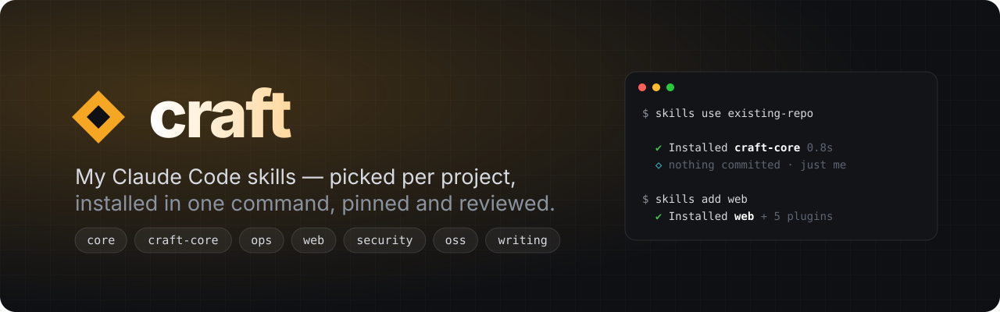
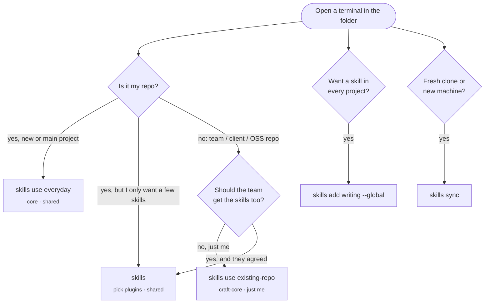

<p align="center">
  
</p>

<p align="center">
  <a href="https://github.com/notsubash/claude-skills/actions/workflows/ci.yml"></a>
  
  
  
</p>

**craft** is my Claude Code plugin marketplace: my own skills, grouped into bundles, plus third-party skills pinned to commits I've read line by line. The `skills` CLI picks what a project needs and installs it through Claude Code's native plugin system, in the scope I want: **shared with the repo**, **just me**, or **everywhere**. It never copies skill files into a project.

<p align="center">
  
</p>

## Quick start

One command, same on Windows, macOS and Linux (needs [Node 22+](https://nodejs.org) and [Claude Code](https://code.claude.com)):

```bash
npm i -g github:notsubash/claude-skills#semver:x
```

(`#semver:x` installs the latest release. Leave it off to track `main`.)

Then, in any project folder:

```bash
skills
```

That's it. It asks what you're doing, where the skills should live, and which ones you want, then installs them. On a fresh clone it notices the project's plugins aren't downloaded yet and offers to fetch them. Restart Claude Code (or run `/reload-plugins`) and the skills are there.

> Just trying it? `npx github:notsubash/claude-skills#semver:x` runs the same picker without installing anything.

Once you know what you want, skip the questions:

```bash
skills use existing-repo        # a scenario: craft-core, just me, nothing committed
skills add senior-pr --local    # a plugin, bundle or single skill name
skills add writing --global     # available in every project
```

---

## Contents

- [Quick start](#quick-start)
- [Which path do I take?](#which-path-do-i-take) ← for specific situations
- [Set up once per machine](#set-up-once-per-machine)
- [Scopes: shared, just me, everywhere](#scopes-shared-just-me-everywhere)
- [What's inside](#whats-inside) and [how to use each skill](#how-to-use-each-skill)
- [The workflow these encode](#the-workflow-these-encode)
- [Command reference](#command-reference)
- [Switches and safeguards](#switches-and-safeguards)
- [Troubleshooting](#troubleshooting)
- [Maintaining the marketplace](#maintaining-the-marketplace): new skills, third-party pins, evals, CI

---

## Which path do I take?



| I'm… | Run | Scope | What changes in the repo |
|---|---|---|---|
| **Starting a new project** I own | `skills use everyday` | shared | `.claude/settings.json` + `.claude/craft.lock.json` (commit both) |
| **In an existing project I own**, want everything | `skills use everyday` (add `frontend` for UI) | shared | same, commit both |
| **In an existing project**, want only one or two skills | `skills` → *Pick plugins myself*, or `skills add security-gate` | shared or just me | shared: two files to commit · just me: nothing |
| **In someone else's repo** (work, client) | `skills use existing-repo` | just me | **nothing**: files are git-excluded |
| **Contributing to open source** | `skills use contribute` | just me | **nothing**, so `.claude/` never lands in your PR |
| **Running an app in production** | `skills use live-app` | shared | two files to commit |
| **Shipping something risky** | `skills use security` | shared | two files to commit |
| Wanting a skill **everywhere** (writing, skill-creator) | `skills add writing --global` | global | nothing (lives in `~/.claude/`) |
| On a **fresh clone or new machine** | `skills` (offers to download) or `skills sync` | whatever the repo declares | nothing, it downloads what settings enable |
| **Editing a skill** in this repo and testing it | `skills add craft-core --local --source local` | just me | nothing; edits apply on `/reload-plugins` |
| **Done with it** | `skills` → *Review or remove*, or `skills remove core` | the one it's in | everything it added is removed |

After any install: restart Claude Code, or run `/reload-plugins` in an open session.

> [!TIP]
> Not sure? Just run `skills`. It shows what's already enabled in each scope, suggests a scope from the folder (git repo → shared, home folder → global), shows each plugin's skills, hooks and safeguards before you pick it, and prints a plan before changing anything.

---

## Set up once per machine

Needs **Node 22+**, **git**, and **Claude Code ≥ 2.1.300** (`npm i -g @anthropic-ai/claude-code@latest`). `gh` is optional (used by `update --dry-run`). Works the same in PowerShell, cmd, bash and zsh on Windows, macOS and Linux; CI tests all three OSes.

| I want to… | Run | Update it later |
|---|---|---|
| **Use the skills** (most of the time) | `npm i -g github:notsubash/claude-skills#semver:x` | `skills self-update` (installs the latest release) |
| **Edit skills** in this repo too | `git clone https://github.com/notsubash/claude-skills && cd claude-skills && npm link` | `skills self-update` (does a `git pull`) |
| Try once, install nothing | `npx github:notsubash/claude-skills#semver:x` | n/a |

Then `skills doctor` checks everything. The CLI is small; the skills themselves install from GitHub through Claude Code, pinned by the lockfile. `npm link` makes `skills` run straight from your clone, so `skills new-skill` and `--source local` work on your edits. No PATH editing on any OS.

**Tab completion** sets itself up the first time you run `skills` in bash, zsh, fish or PowerShell, once per shell, and tells you when it does. From the next terminal, `skills add cr<Tab>` completes plugin and skill names, `skills use <Tab>` lists scenarios, and `--<Tab>` shows the flags that command takes, with descriptions where the shell can show them. Names are read from the marketplace each time you press Tab, so new plugins show up without reinstalling, and `skills self-update` refreshes the hook itself. `skills completion install [shell]` sets it up by hand (say, for a second shell); `skills completion uninstall` turns it off and it stays off.

**Versions and updates.** `skills --version` prints the version you're on. Each release is a tag (`v1.0.0`) with notes in [CHANGELOG.md](CHANGELOG.md). Once a day `skills` checks GitHub in the background, and when a newer release is out it prints one line after the command: `update available: 1.0.0 → 1.1.0 · skills self-update`. Nothing is printed in CI or when output is piped. Turn the check off with `SKILLS_NO_UPDATE_CHECK=1`.

<details>
<summary><b>Without the CLI</b> (another machine, or just checking the marketplace works)</summary>

The marketplace is plain Claude Code, so the native commands work too. You lose the scenario recipes, the lockfile, the safeguards and git-excluding just-me files.

```text
/plugin marketplace add notsubash/claude-skills
/plugin install craft-core@craft
```

or from a shell: `claude plugin marketplace add notsubash/claude-skills --scope project` then `claude plugin install core@craft --scope project`.
</details>

---

## Scopes: shared, just me, everywhere

| Scope | Flag | Settings file | Lockfile | Who gets it |
|---|---|---|---|---|
| **this project (shared)** | *(default)* | `.claude/settings.json` | `.claude/craft.lock.json` | everyone who clones the repo and runs `skills sync` |
| **this project (just me)** | `--local` | `.claude/settings.local.json` | `.claude/craft.lock.local.json` | only me; both files go in `.git/info/exclude`, so `git status` stays clean |
| **everywhere (global)** | `--global` | `~/.claude/settings.json` | `~/.claude/craft.lock.json` | every project on this machine |

Scopes stack: a session in a repo loads global + shared + just-me plugins together. Claude Code caches plugin files under `~/.claude/plugins/cache/`, never in the repo.

**Project settings enable plugins but don't download them.** That's why a teammate (or me on another machine) runs `skills sync` once after cloning. `skills doctor` tells you when it's needed.

---

## What's inside

```text
skills list           # everything, with [global] [project] [just me] tags for what's enabled
skills info <name>    # one plugin or skill: its skills, hooks, safeguards, pin, where it's enabled
```

### Bundles

| Bundle | Brings | Skills |
|---|---|---|
| **core** | craft-core + ops + [superpowers](https://github.com/obra/superpowers) + [matt-eng](https://github.com/mattpocock/skills) + [ponytail](https://github.com/DietrichGebert/ponytail) | 42 |
| **web** | craft-web + [stageshow](https://github.com/benjitaylor/skills) + [charles-design](https://github.com/LemonFace0309/charles-skills) + [emil-design-eng](https://github.com/emilkowalski/skills) + [playwright-cli](https://github.com/microsoft/playwright-cli). [impeccable](https://github.com/pbakaus/impeccable) is opt-in | 6 |
| **security** | Anthropic's [security-guidance](https://github.com/anthropics/claude-plugins-official/tree/main/plugins/security-guidance) hooks + Cloudflare's [security-audit](https://github.com/cloudflare/security-audit-skill) | 1 + hooks |

### My plugins (no dependencies, no third-party code)

| Plugin | Skills |
|---|---|
| **craft-core** | senior-pr, security-gate, project-docs, product-lens, architecture-decisions, test-integrity, deepen + the first-prompt hook, the push guard, the test guard and the `terse` output style |
| **ops** | incident-response, bug-triage, observability, dep-upgrade, release, maintenance-routine |
| **craft-web** | ui-pipeline |
| **oss** | oss-contribute |
| **writing** | human-voice, figure-check |

Every third-party plugin also installs on its own (`skills add playwright-cli`). Naming a skill installs the plugin that ships it (`skills add brainstorming` → superpowers), since Claude Code installs plugins, not single skills.

### How to use each skill

Skills trigger on their own when what you type matches their description. These are the phrasings they're tuned for. You can always force one with `/plugin:skill`, e.g. `/craft-core:senior-pr`.

| Skill | What it does | Say something like |
|---|---|---|
| **deepen** · craft-core | Rewrites your first prompt of each session into the version a top professional would write, then waits for your OK. Manual otherwise. | *(automatic on the first prompt)* · `/craft-core:deepen <prompt>` · start a prompt with `!raw` to skip |
| **product-lens** · craft-core | Evidence vs assumptions, the user and pain, outcome metric with guardrails, options incl. do nothing, appetite, thin slice, kill criterion → build / test first / don't build | "is this feature worth building?", "what should we build next?", "review this PRD", "prep customer interviews" |
| **project-docs** · craft-core | Interviews you, then writes only the docs the project needs: lean CLAUDE.md, PRODUCT.md, decision log + ADRs, glossary, backlog | "set up the docs", "create a CLAUDE.md", "our CLAUDE.md is bloated" |
| **architecture-decisions** · craft-core | Door size → at most three measurable drivers → options incl. keep-what-exists → spike → one-page ADR with a confirmation check (fitness function) and revisit triggers; design docs, superseding, ADR review. `check-adrs.mjs` validates the folder | "Postgres queue or Redis?", "write an ADR", "design doc for splitting the monolith", "review this ADR" |
| **test-integrity** · craft-core | Tests that would catch a real bug: public behavior, real dependencies, independent expected values, a failing test before every fix, proof each test can fail. Failing tests get fixed in the code, never by skipping, loosening or special-casing them. `check-test-diff.mjs` checks the branch | "add tests for X", "get CI green", "make the tests pass", "are these tests any good?" |
| **security-gate** · craft-core | Scans the branch diff for secrets, vulnerable deps and risky paths; writes a CLEARED/BLOCKED report the push guard checks | "security check before I push", "clear this branch", "run the gate" |
| **senior-pr** · craft-core | One focused conventional commit per logical change, and a PR body with what, why, risk and how it was tested | "commit this", "raise a PR", "give the PR body", "make this PR senior" |
| **incident-response** · ops | Declare → severity → roles → mitigate first (rollback, flag off) → status updates on a cadence → handoff → blameless postmortem with sourced timeline and owned, ticketed actions. `check-postmortem.mjs` validates it | "checkout is down", "we're getting 500s since the deploy", "status page update", "write the postmortem" |
| **bug-triage** · ops | Report → evidence → severity → minimal repro (bisect) → failing test → root-cause fix → data repair → reply | paste a stack trace, Sentry issue or ticket; "this is broken in prod" |
| **observability** · ops | Wide events, golden signals, SLOs and error budgets, burn-rate alerts with runbooks | "add logging/monitoring", "set up Sentry/OpenTelemetry", "define SLOs", "too many alerts" |
| **dep-upgrade** · ops | 7-day release-age cooldown, install scripts off, lockfile review, majors one at a time, compromise response | "update dependencies", "set up Renovate", "fix this CVE", "are we hit by the X compromise?" |
| **release** · ops | Version, user-facing changelog, expand/contract migrations, progressive rollout with rollback triggers, flag cleanup | "cut a release", "write the changelog", "deploy to prod", "roll back", "hotfix" |
| **maintenance-routine** · ops | Weekly / monthly / quarterly checks → red-amber-green report with owned actions; can schedule itself | "weekly maintenance check", "health review", "schedule recurring checks" |
| **ui-pipeline** · craft-web | Direction & critique → stageshow demos → charles-unslop → emil polish, verified with playwright screenshots | "redesign this page", "this UI looks generic / AI-made", "polish the animations" |
| **oss-contribute** · oss | Fork + upstream, contribution rules, pick and scope an issue, test-first fix, PR in the project's conventions; teaches as it goes | "I forked X, want to contribute", "which issue should I take?" |
| **human-voice** · writing | Drafts in your voice (video narration, replies, posts), every claim checked against the source | "make it sound like me", "reply to this comment", "answer this application question" |
| **figure-check** · writing | Recomputes every number, label, axis and formula in code before you publish, reading the Manim scene source against what it draws | "check the numbers in this chart/video/post", "is this factually right?" |

**Third-party highlights** (in core/web): `superpowers:brainstorming` → `writing-plans` → `test-driven-development` / `subagent-driven-development`; `matt-eng:grill-with-docs` (interviews you, writes ADRs), `to-spec`, `to-tickets`, `domain-modeling`; `ponytail` (keeps solutions simple; `/ponytail-review`); `charles-unslop`, `emil-design-eng`, `playwright-cli`, `stageshow`. Full read-throughs in [third_party/REVIEW.md](third_party/REVIEW.md).

---

## The workflow these encode

| Stage | Skills |
|---|---|
| 1. **Think** | `deepen` hook on the first prompt → `grill-with-docs` interview, ADRs, glossary |
| 2. **Decide what to build** | `product-lens` → build, test first, or don't build |
| 2b. **Decide how** | `architecture-decisions` for one-way doors → design doc and ADRs, with fitness functions in CI |
| 3. **Document** | `project-docs` |
| 4. **Plan** | superpowers `brainstorming` → `writing-plans`, or `to-spec` → `to-tickets` |
| 5. **Build** | `test-integrity` (with the test guard hook), `test-driven-development`, `subagent-driven-development`, `domain-modeling`, `codebase-design`, ponytail |
| 6. **UI** | `ui-pipeline` (impeccable if installed → stageshow → charles-unslop → emil-design-eng → playwright-cli) |
| 7. **Ship** | `security-gate` → push guard on `git push` / `gh pr create` → `senior-pr` |
| 8. **Release** | `release` |
| 9. **Run it** | `incident-response` when it's down, `observability`, `bug-triage`, `dep-upgrade`, `maintenance-routine` on a schedule |

---

## Command reference

| Command | Does |
|---|---|
| `skills` | Interactive: scenario → scope → plugins (pre-checked with what's installed; uncheck to remove) → plan → apply |
| `skills use [scenario]` | Install a scenario recipe. No argument lists them: `everyday`, `existing-repo`, `frontend`, `live-app`, `security`, `contribute`, `writing`, `skill-dev` |
| `skills add <name>...` | Plugins, bundles or skill names, several at once |
| `skills remove <name>...` | Uninstall, prune dependencies nothing else needs, undo its safeguards, tidy empty settings |
| `skills list` | Catalog, with what's enabled in each scope |
| `skills info <name>` | Skills, hooks, safeguards, upstream pin, bundles it's part of, where it's enabled |
| `skills sync` | Download every plugin this project's shared and just-me settings enable |
| `skills update [--dry-run]` | Refresh the marketplace and plugins in every scope with a lockfile. Dry run shows upstream compare links and changed files |
| `skills doctor` | Tools, manifest, and per scope: marketplace, lockfile vs settings, downloads, safeguards |
| `skills new-skill <name> --bundle <plugin>` | New SKILL.md + 7 eval cases from `templates/` |
| `skills vet <owner/repo> --sha <sha>` | Scan a third-party skill before pinning it |
| `skills self-update` | Update the CLI itself to the latest release (`1.0.0 → 1.1.0`) and refresh tab completion. A git clone does a `git pull` instead |
| `skills --version` | The version you're on |
| `skills completion install [shell]` | Tab completion for bash, zsh, fish or PowerShell (detected if you leave it out; it also sets itself up on first run). `skills completion uninstall` removes it; `skills completion <shell>` prints the script |

| Flag | Effect |
|---|---|
| `--local` · `--global` | Just-me or global scope (default: this project, shared). `--scope project\|local\|user` also works |
| `--dir PATH` | Act on another folder instead of the current one |
| `--source github\|local\|PATH` | Where the marketplace comes from. `local` = this clone, for unpushed changes |
| `--yes` | Skip the interactive confirm |
| `--no-safeguards` | Don't apply the review safeguards below |
| `--accept-impeccable` | Required to install impeccable |

Output turns colorless when piped, in CI, or with `NO_COLOR=1`. In a shell without a real TTY (Git Bash under mintty), the picker falls back to numbered prompts.

---

## Switches and safeguards

| Setting | Effect |
|---|---|
| `CRAFT_DEEPEN=off` | Turn off the first-prompt deepen hook everywhere. A prompt starting with `!raw` skips it for that session |
| `CRAFT_SECURITY_GATE=warn` *(default)* · `enforce` · `off` | Push guard: warn when HEAD has no CLEARED report, block it, or stay silent |
| `CRAFT_TEST_GUARD=ask` *(default)* · `enforce` · `warn` · `off` | Test guard: before an edit or command that weakens tests (skip, `.only`, deleted test or assertion, excluded tests or lowered coverage in config, `\|\| true` on a test run, `--no-verify`), ask you, block it, only tell Claude, or stay silent. Changed expected values and swallowed errors go through, but Claude is told to explain them |
| Output style `craft-core:terse` | Short replies: answer first, one recommendation, never drops warnings. Pick it in `/config` → Output style, or `"outputStyle": "craft-core:terse"` |

Put the `CRAFT_*` switches in your shell profile or the `env` block of `~/.claude/settings.json`.

Every third-party plugin was read line by line before adoption ([third_party/REVIEW.md](third_party/REVIEW.md)). `skills add` applies these into the same scope's settings, and `skills remove` takes them out again:

| Plugin | What `skills add` sets | Why |
|---|---|---|
| superpowers | `env.SUPERPOWERS_DISABLE_TELEMETRY=1` | No third-party logo request from the brainstorming page |
| ponytail | options `ledger=false`, `sendNames=false` (user settings, via `claude plugin configure`) | No prompt snippets in `~/.config/ponytail` or any webhook |
| security-guidance | `SECURITY_REVIEW_MODEL` and `SG_AGENTIC_MODEL` = `claude-sonnet-5-5` | Per-turn reviews on Sonnet instead of uncapped Opus |
| playwright-cli | deny `playwright-cli attach`; ask before cookie, state, `run-code`, `kill-all`, `delete-data` | Never attach to your everyday browser profile |
| impeccable | not in any bundle; refuses without `--accept-impeccable` (the picker asks) | Its hooks run an unreviewable prebuilt binary with network access on every edit |

Two things stay manual: decline ponytail's offer to add a statusLine, and decline impeccable's account sign-in if you install it.

---

## Troubleshooting

| Symptom | Fix |
|---|---|
| A skill doesn't show up | `/reload-plugins` or restart Claude Code. Then `skills doctor` |
| Doctor says "0/N plugins downloaded" | `skills sync` (fresh clone or new machine) |
| "you're in your home folder" | Project settings there *are* your global settings. Use `--global`, or `cd` into a project |
| `skills: command not found` | Open a new terminal after `npm i -g`. Still missing? `npm prefix -g` must be on PATH (nvm/fnm set this up) |
| "Claude Code is not installed" | `npm i -g @anthropic-ai/claude-code`, then `skills` again |
| Tab does nothing in PowerShell | Windows ships with scripts disabled, so profiles don't load. `skills completion install` offers the fix (`Set-ExecutionPolicy -Scope CurrentUser RemoteSigned`); `skills doctor` reports it |
| Tab does nothing after install | Open a new terminal, or `source ~/.bashrc` (bash), `exec zsh`, `exec fish`, `. $PROFILE` (PowerShell) |
| Tab does nothing in bash on Windows | Typing `bash` in PowerShell or cmd often opens **WSL**, not Git Bash, and WSL has its own home folder. Run `skills` once inside that shell and it sets up completion there too |
| Arrow keys don't work in Git Bash | mintty has no real TTY; answer the numbered prompts, or use Windows Terminal / `winpty skills` |
| Lockfile doesn't match settings | Someone edited settings by hand. `skills remove <x>` then `skills add <x>` in that scope |
| Want to see what a plugin does before installing | `skills info <name>`, or the details pane in `skills` |
| Something's off and you want a clean slate | `skills remove <each>` in each scope; `git status` is empty afterwards (CI checks this) |

---

## Maintaining the marketplace

<details>
<summary><b>Create a new skill</b></summary>

```bash
skills new-skill api-contract --bundle craft-core --description "Design and review HTTP API contracts ... Use when ..."
```

Creates `plugins/craft-core/skills/api-contract/SKILL.md` and seven eval cases under `plugins/craft-core/evals/api-contract-*`. Then the [skill-creator](https://github.com/anthropics/claude-plugins-official/tree/main/plugins/skill-creator) loop (`skills use skill-dev` installs it):

1. **Write the description first.** It's what makes the skill trigger: what it does, then "Use when ..." with the words you'd actually type, and a near-miss it isn't for.
2. **Write the body** as the steps a top professional takes, in order, under 500 lines. Reference detail goes in sibling files; scripts in Node or Python so they run in both shells.
3. **Fill in the evals:** 3 prompts that should trigger, 3 near-misses that shouldn't, 1 real task with graders.
4. **Try it live:** `skills add craft-core --local --source local` in any project, then `/reload-plugins` after each edit.
5. **Run the evals:**
   ```bash
   claude plugin validate plugins/craft-core
   claude plugin eval plugins/craft-core --case "api-contract-*trigger*" --ablation none --runs 3 --no-publish
   claude plugin eval plugins/craft-core --case "api-contract-task*" --ablation with-without --runs 3 --no-publish
   ```
6. **Iterate** until triggers pass and the task beats the no-skill baseline. Add it to `BLURB`/the skill table if it changes what a plugin is for. `node scripts/ci-check.mjs` enforces eval coverage.

Skills go in the dependency-free plugins (`craft-core`, `ops`, …). Bundles with dependencies can't hold skills, because `claude plugin eval` can't load a plugin whose dependencies are missing.
</details>

<details>
<summary><b>What evals are, and what they cost</b></summary>

An eval runs real Claude sessions against prompts and scores them: did the skill load when it should, stay out when it shouldn't, and does a real task score higher with the skill than without (the Δ in [evals/REPORT.md](evals/REPORT.md))?

- **Locally, logged in with a Claude plan**, runs use your plan's limits. The "$" in the report is a list-price estimate.
- **In CI** the eval job needs an `ANTHROPIC_API_KEY` secret (billed per token) and only runs when you start the workflow by hand with `evals` ticked.
- About 24 runs per skill; one skill was ~$2.40 at list price. Narrow with `--case "<skill>-*"` and `--runs 1` while iterating.
</details>

<details>
<summary><b>Add a third-party skill</b></summary>

Third-party skills aren't copied here. A marketplace entry points at the upstream repo at a reviewed commit.

1. **Pick a full commit SHA**, never a branch: `gh api repos/OWNER/REPO/commits/main --jq .sha`
2. **Vet it:** `skills vet OWNER/REPO --sha <sha> --path skills/the-skill --name the-skill`. It scans every file (scripts, hooks, network, process spawning, secrets, home-directory writes, installs, prompt-injection phrases, hidden unicode) and drafts `third_party/reviews/the-skill.md`. **Then read the files yourself.** A clean scan is a reading list, not a verdict.
3. **Add the entry** to `.claude-plugin/marketplace.json` with `"category": "third-party"`:
   - whole repo: `"source": { "source": "url", "url": "https://github.com/OWNER/REPO.git", "sha": "<sha>" }`
   - one folder: `"source": { "source": "git-subdir", "url": "...", "path": "skills/the-skill", "sha": "<sha>" }`
   - a subset of skills: add `"strict": false, "skills": ["./a", "./b"]` (see `matt-eng`)
4. **Record the review** in `third_party/manifest.json` and `third_party/REVIEW.md`.
5. Add its skills to `THIRD_PARTY_SKILLS` and a one-liner to `BLURB` in [cli/lib/catalog.mjs](cli/lib/catalog.mjs), optionally add it to a bundle, run `node scripts/ci-check.mjs`, open a PR. CI fails on a non-SHA pin or a missing review.
</details>

<details>
<summary><b>Update a pinned third-party skill</b></summary>

1. `skills update --dry-run` shows the new commit, a compare link and changed files under the pinned path.
2. Review only the diff `https://github.com/OWNER/REPO/compare/<old>...<new>`: new or changed hooks, scripts, `allowed-tools`, network calls, install steps.
3. `skills vet OWNER/REPO --sha <new> --path ...` for a fresh scan.
4. Bump the SHA in **both** `marketplace.json` and `third_party/manifest.json`, update the review note and date. CI rejects a one-sided bump.
5. Merge, then `skills update` in each project. To roll back: revert the commit and `skills update`.
</details>

<details>
<summary><b>Proof it works (CI)</b></summary>

`.github/workflows/ci.yml` runs on clean `ubuntu-latest` and `windows-latest` with a pinned Claude Code version:

1. `claude plugin validate` on the marketplace and every plugin
2. `scripts/ci-check.mjs`: full-SHA pins, a review per pin, skill frontmatter rules, eval coverage
3. `scripts/install-test.mjs core`: installs core into an empty git repo with an isolated config, starts a real `claude -p` session, compares its skills to `tests/expected/core.json` exactly, uninstalls, requires `git status` to be empty. No API key needed
4. `scripts/install-test.mjs craft-core --local`: same for a just-me install, and `git status` must be empty right after the install too
5. `scripts/completion-test.mjs`: presses Tab in real bash, zsh, fish and PowerShell; `scripts/version-test.mjs`: update check, and a changelog entry for the package.json version

Pushing a `v*` tag runs `.github/workflows/release.yml`, which checks the tag matches `package.json` and publishes the GitHub release with that version's CHANGELOG section.

**Cutting a release:** in a PR, bump `version` in `package.json` and add a `## [x.y.z] - date` section to `CHANGELOG.md`. After it merges, `node scripts/release.mjs` on main tags it and pushes the tag.

Evals are a manual job (`workflow_dispatch` with `evals: true`). Latest results: [evals/REPORT.md](evals/REPORT.md).

The README art is generated: `node scripts/readme-assets.mjs` rewrites `assets/banner.svg` and `assets/demo.svg`.
</details>

<details>
<summary><b>Repo layout</b></summary>

```text
.claude-plugin/marketplace.json   the craft marketplace: own plugins + pinned third-party entries
plugins/<name>/                   own plugins (craft-core, craft-web, ops, oss, writing) and bundles (core, web, security)
  skills/<skill>/SKILL.md
  evals/<skill>-{trigger,no-trigger,task}-N/
  hooks/                          craft-core only: deepen.mjs, push-guard.mjs
cli/skills.mjs                    the CLI (bin/skills, skills.cmd, skills.ps1 are shims)
cli/lib/                          catalog.mjs (blurbs, scenarios), picker.mjs (prompts), ui.mjs (look), scan.mjs (vet), completion.mjs (Tab), update.mjs (update check)
third_party/                      manifest.json + REVIEW.md: one review per pin
scripts/                          ci-check, install-test, completion-test, version-test, release, eval-report, readme-assets
templates/                        new-skill templates
tests/expected/                   exact skill sets an install must produce
assets/                           README banner and demo (generated)
```
</details>
